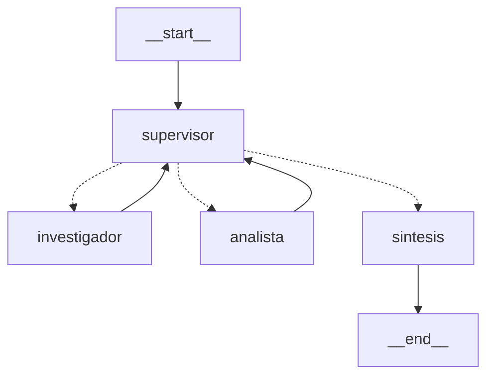

# Pre-entrega 6: Orquestador Multi-Agente Especializado

Este repositorio contiene un prototipo funcional de un Orquestador Multi-Agente de Análisis e Investigación, construido utilizando **LangGraph** y el modelo **Gemini 3.5 Flash** de Google.

El sistema procesa consultas de usuarios derivando tareas específicas a agentes especializados y realizando una síntesis final, sin perder el contexto de la conversación.

## Instrucciones de Uso

Para ejecutar este orquestador en tu entorno local, seguí estos pasos:

1. **Clonar el repositorio:**

```bash
   git clone <URL_DE_TU_REPOSITORIO>
   cd <NOMBRE_DE_LA_CARPETA>
```

2. **Crear y activar el entorno virtual (Windows):**

```bash
   python -m venv venv
   .\venv\Scripts\activate
```

3. **Instalar dependencias:**

```bash
   pip install -r requirements.txt
```

4. **Configurar las credenciales:** Creá un archivo llamado `.env` en la raíz del proyecto y agregá tu clave de API de Google (y Pinecone si integrás la base vectorial real):

```env
   GOOGLE_API_KEY="tu_clave_de_google_aqui"
   PINECONE_API_KEY="tu_clave_de_pinecone_aqui"
```

5. **Ejecutar el orquestador:**

```bash
   python main.py
```

> **Nota:** El script ejecutará automáticamente una consulta de prueba sobre los días de vacaciones acumulados por un empleado para demostrar el flujo de delegación.

## Topología Elegida

Se implementó una **Topología Jerárquica con un Supervisor Centralizado**.

- **Nodo Supervisor:** Actúa como un router inteligente. Evalúa el estado de la conversación y decide dinámicamente si la tarea requiere investigación adicional, cálculos matemáticos, o si ya está lista para la síntesis final.
- **Por qué se eligió:** Esta arquitectura previene la comunicación descontrolada entre agentes especialistas. Al obligar a que toda interacción pase por el Supervisor, se evita el riesgo de bucles infinitos y derivas conversacionales. Además, se implementó un límite estricto de iteraciones (`MAX_PASOS = 6`) como condición de parada para garantizar que el sistema siempre retorne una respuesta.

## Especialización de Agentes y Herramientas

El orquestador cuenta con dos especialistas acotados:

1. **Agente Investigador:** Posee una herramienta propia para consultar una base de datos de las políticas internas de la empresa. Su función se limita estrictamente a la extracción de datos concretos y sus fuentes.
2. **Agente Analista:** Equipado con una herramienta de calculadora segura (basada en el módulo `ast` de Python). Su rol es procesar los números obtenidos por el investigador y realizar los cálculos matemáticos requeridos, sin inventar ni buscar datos nuevos.

## Gestión de Estado y Resolución de Conflictos

Para evitar la contaminación de contexto y la pérdida de información en la comunicación asíncrona, se utilizó una estructura de estado (`AgentState`) heredada de `MessagesState`.

La clave de la resolución de conflictos radica en el campo `contribuciones`, el cual utiliza el reducer `operator.add`. En lugar de sobrescribir el estado en cada turno, los aportes de los agentes se suman a una lista compartida. Esto permite que el Supervisor y el nodo de Síntesis tengan acceso a un historial detallado de quién aportó qué información, manteniendo la coherencia de los datos hasta la respuesta final al usuario.

## Visualización del Grafo (Diagrama)

A continuación se representa el flujo de trabajo del orquestador:

